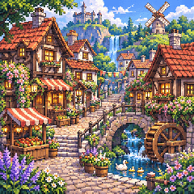
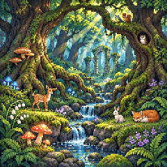
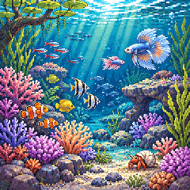

# サンニー — 6世界・8景色の完成イラストと成長デザイン

**v0.5への実装状況:** 完成イラスト16枚（6世界+川・深海の追加2景色、それぞれ誕生時と成熟時）を`assets/`に配置済み。スマホでは`www/index.html`が読み込み、本体では`tools/build_display_assets.js`が変換したRGB565を`firmware/round_screen.py`が表示する。実機の表示速度・色・向きは未検証。以下は制作途中のデザイン履歴を含む。

このフォルダは**独立したデザイン検証用**。Codexが進めている実機ファームウェア（firmware/main.py / world_model.py）を上書きしない。v2では、幾何学的な試作背景を、AI生成を元に加工した**描き込みのあるピクセルアート背景**へ変更した。

preview.html をPCかスマホのブラウザで開くと、街・森・水槽・自然・共生・魔法の6つの世界を切り替え、**DAY 0〜30**の姿を自由に比較できる。自動再生・1日/7日早送りも用意。外部通信・音声録音・保存データの書き換えは行わない。

## 成熟時の画面イメージ

| 街 | 森 | 水槽 |
|---|---|---|
|  |  |  |
| 自然の浮島 | 共生の村 | 魔法の世界 |
|  |  |  |

早期の画面は同じフォルダ内の `*-young.png`。比較静止画を18枚書き出すには `node PocketWorld/design/export_frames.js <出力先ディレクトリ>` を使う。

## 画面デザインの基本

- 対象ハード：Waveshare ESP32-S3-Touch-LCD-1.28、円形LCD **240×240**。
- 表現：**240×240の絵柄**を各世界の背景に使用。中央は動き・主役、外周は背景と装飾にして情報を詰めすぎない。小さく動く演出は120×120相当の仮想座標で重ねる。
- 世界ごとに `assets/<world>-young.png`（誕生時）と `assets/<world>-mature.png`（成熟時）の2枚を用意。いずれも240×240のパレットPNG。6世界で計12枚。
- 画像は**絵柄の試作素材**であり、細部まで手作業で描いたドット絵や、ESP32へ搭載済みの画像という意味ではない。現状はブラウザ上で2枚をクロスフェードする。直接の実機転送・フォント描画・省電力最適化は未実施。
- 配色：日中の明るい緑・水色・暖色、夜は紺色・紫色・窓の灯り・ホタルを使用。
- アニメーション：小魚の遊泳、雲、住民の往来、木漏れ日、精霊の点滅。実機で軽量描画へ移植する際は部分更新を優先する。
- 一度に生き物を大量表示せず、**実際の数値は保存しつつ描画数を上限管理**して視認性と処理時間を守る。
- タッチによる世界切替やエフェクトは**別途実機側で実装する**。プレビューのマウス・スライダー操作がそのままESP32で動くわけではない。

## 成長とイベントの新しいバランス案

今ある firmware/world_model.py は1分刻みで6世界を独立成長させる。一方、家が140分ごとに増えて16軒で上限になるなど、街が比較的早く完成する。長期鑑賞に合わせて**成長速度を段階化する案**をここで提案する。

| 世界 | DAY 0 | DAY 3 | DAY 7 | DAY 14 | DAY 30 |
|---|---|---|---|---|---|
| 街 | 家1軒 | 数軒と小道 | 店と街灯 | にぎやかな住宅街 | 誕生祭 |
| 森 | 芽・若木 | きのこ | うさぎ | ホタル | 大きな古木 |
| 水槽 | 川の小魚2匹 | エビ | 海への水路 | 珊瑚礁 | 深海の発光生物 |
| 自然 | 浮島の草 | 木と小鳥 | 蝶 | 滝 | 緑の楽園 |
| 共生 | 家と木 | 木の橋 | 動物が村へ | 緑化した屋根 | 森と村が一体化 |
| 魔法 | 小さな結晶 | 精霊 | 流れ星 | 光の輪 | 星の塔 |

**上のDAY 7/30等はプレビューのデザイン案であり、現在の実機コードの実際の解放時間ではない。** 例えば既存の水槽エンジンは海を1日、深海を3日で解放する。スケジュール変更は実機テストが安定した後に別タスクとして検討する。

プレビューでは progress = log2(1+days)/log2(31) を**生き物の数などの表示値**に用い、**背景絵は day/30 で誕生時から成熟時へフェード**させている。これは表現案であり、建物や木を部品単位で増やす実装ではまだない。実機版に導入するときは浮動小数点や数百回の再計算に頼らず、離散的な成長段階・時刻・イベントIDを保存して再現可能にする。

## 世界間の共通ルール

1. **何もしなくても世界は動く。** すべての世界がバックグラウンドで独立して進行する。
2. **観察がご褒美。** 操作しなくても小さい変化が積み重なり、たまに珍しい生き物・発見イベントが発生する。
3. **睡眠中も経過時間で育つ。** 既存実装の経過時間復元は最大48時間/回という保護がある。週末の常時スリープとの整合はハードウェア検証後に調整する。
4. **音・傾きで永久成長を乱さない。** マイクは音量に基づく軽い反応、ジャイロは見た目の視差。偶発的な一振りで大量増殖させない。
5. **希少イベントは記録する。** 日付・世界ID・イベントID・短文を端末側に残し、Androidでは「今日の出来事」として見る。
6. **世界を壊す要素はない。** デスクに置きっぱなしでも、魚や住民が全滅するようなストレスは導入しない。

## スマホ表示との役割分担

- **サンニー本体**：丸形240×240内の美しいアニメーション。画面の文字は最小限。
- **スマホ**：同じ世界を拡大し、建物/住民/生き物の数、発見したイベント、成長履歴、時間設定を表示する。
- 本体・スマホが別の世界を見ていてもよい。表示対象はサンニーの世界データに依存し、**双方が独自に世界を進行させて二重計算しない**。

## 実機移植の条件

- 本プレビューの描画用JSをESP32に直接コピーしない。MicroPythonのGC9A01用描画関数へ作り替える。PNG12枚をそのままRGB565へ変換すると**240×240×2×12＝1,382,400バイト**になるため、ESP32の利用可能フラッシュ・読み込み速度・メモリに合わせた形式を選ぶ。
- 円の外側に情報を置かない。画面縁の文字・タッチ操作は見切れないよう安全領域を確保する。
- 6つの世界の背景・生き物・建物をコンパクトな手続き的スプライトまたは小さいRGB565画像へ落とす。現在の2枚クロスフェードを実機でそのまま毎フレーム行わない。離散的な段階画像や差分更新を検討する。
- 実際のESP32接続・FPS・発熱・電池消費は未検証。**表示とジャイロ・I²S・Wi-Fiの同時動作確認が必要**。

## チェックリスト

- [x] 街/森/水槽/自然/共生/魔法の6世界を独立表示できるデザインプレビュー。
- [x] DAY 0〜30の成長前後・イベントを見られる。
- [x] 丸形240×240の描き込んだ背景画像12枚と、小さく動く演出。
- [x] 誕生時と成熟時で6世界の風景が変わる。
- [x] 画面のアニメーションと時間早送りを分離した。
- [ ] 実機GC9A01で描画・タッチ実装。
- [ ] 成長速度の最終決定と world_model.py への安全な反映。
- [ ] Android観察画面との共通イベント履歴。
- [ ] 本体稼働時・スリープ時の電池測定。
