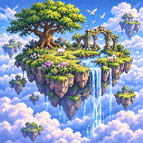
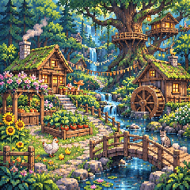

# サンニー — 6世界・8景色の完成イラストと成長デザイン

**実装状況:** 完成イラスト17枚（6世界+川・深海の追加2景色に各2段階、共生の世界だけ中間段階を追加）を`assets/`に配置済み。スマホでは`www/index.html`が読み込み、本体では`tools/build_display_assets.js`が変換したRGB565を`firmware/round_screen.py`が表示する。実機の表示速度・色・向きは未検証。以下は制作途中のデザイン履歴を含む。

**新しい街の演出:** 現行実装は家1軒・住民2人から始まり、住民を画面の物理ピクセルで幅1×高さ3（頭・服・足）として小刻みに歩かせます。実機・Android観察ページ・この独立プレビューでサイズを統一。街の背景の合成割合は経過日数ではなく、保存された建物数（1軒〜14軒の段階）に連動します。合成で街並みの密度を表現するため、建物の絵が数値と**厳密に1棟ずつ対応するわけではありません**。

**自然ワールドの新デザイン（2026-11-19）:** `nature-young.png` と `nature-mature.png` を、同じ大きな浮遊島を遠くから斜めに見下ろす構図へ更新。さらに俯瞰角度を上げて、芝生の上面を広く、岩の下側を薄くした。80×80の仮想ドットを最近傍拡大して240×240の画面用画像を作り、あえて粒の大きいドット絵にした。最初は若木・草原・小さな水流だけで、成長すると大樹・花畑・滝・鳥や蝶が現れる。人工建造物や画面上の世界名は置かない。2枚の段階画像はクロスフェードし、プレビューでは成長後に小さな滝の輝きを描画する。ESP32実機での画面表示は引き続き未検証。

**共生ワールドの新デザイン（2026-11-19）:** `hybrid-young.png`／`hybrid-mid.png`／`hybrid-mature.png` の3段階に更新。①段々村を基本に、②大樹の集落と③湖上集落を同じ地形に統合した。草原に小屋1軒と住民2人から始まり、DAY 10に畑と橋のある段々村、DAY 30に大樹のツリーハウスと湖上の家を備えた村へ育つ。120×120のドット格子を240×240へ最近傍拡大。ブラウザ・Android観察画面・ESP32用RGB565では同じ3枚を使い、実機は各時点で2枚だけストリーム合成する。描かれた家の数とシミュレーション内部の建築数は完全な1対1ではない。実機表示は未検証。

**共生ワールドの微細アニメーション:** 実機側は3か所の葉・湖4か所・滝2か所に1〜2ピクセルの小さなハイライトを置き、毎フレーム前の描画領域をRGB565原画から復元する。風と雨では枝葉の揺れ幅・速度が変化。住民は物理1×3ピクセルのまま陸側を歩く。観察Webページ・独立プレビューも同じ目印を使う。広い領域の再描画やシミュレーションの成長値変更は行わない。

このフォルダは**独立したデザイン検証用**。Codexが進めている実機ファームウェア（firmware/main.py / world_model.py）を上書きしない。v2では、幾何学的な試作背景を、AI生成を元に加工した**描き込みのあるピクセルアート背景**へ変更した。

preview.html をPCかスマホのブラウザで開くと、街・森・水槽・自然・共生・魔法の6つの世界を切り替え、**DAY 0〜30**の姿を自由に比較できる。自動再生・1日/7日早送りも用意。外部通信・音声録音・保存データの書き換えは行わない。

## 成熟時の画面イメージ

| 街 | 森 | 水槽 |
|---|---|---|
|  |  |  |
| 自然の浮島 | 共生の村 | 魔法の世界 |
|  |  |  |

早期の画面は同じフォルダ内の `*-young.png`。共生だけは `hybrid-mid.png` もある。比較静止画を18枚書き出すには `node PocketWorld/design/export_frames.js <出力先ディレクトリ>` を使う。

## 画面デザインの基本

- 対象ハード：Waveshare ESP32-S3-Touch-LCD-1.28、円形LCD **240×240**。
- 表現：**240×240の絵柄**を各世界の背景に使用。中央は動き・主役、外周は背景と装飾にして情報を詰めすぎない。住民だけは本体の物理240×240座標で厳密な1×3ピクセルに描き、その他の小さい装飾は120×120相当の仮想座標も使う。
- 原則として `assets/<world>-young.png`（誕生時）と `assets/<world>-mature.png`（成熟時）を使用。共生の世界は `hybrid-mid.png` も使う。すべて240×240のパレットPNG。
- 画像は**AI生成原画から加工した試作素材**であり、手作業で細部まで打ったドット絵やESP32実機に転送済みの画像という意味ではない。実機転送・省電力最適化は未検証。
- 配色：日中の明るい緑・水色・暖色、夜は紺色・紫色・窓の灯り・ホタルを使用。
- アニメーション：小魚の遊泳、雲、住民の往来、木漏れ日、精霊の点滅。実機で軽量描画へ移植する際は部分更新を優先する。
- 一度に生き物を大量表示せず、**実際の数値は保存しつつ描画数を上限管理**して視認性と処理時間を守る。
- タッチによる世界切替やエフェクトは**別途実機側で実装する**。プレビューのマウス・スライダー操作がそのままESP32で動くわけではない。

## 成長とイベントの新しいバランス案

今ある firmware/world_model.py は1分刻みで6世界を独立成長させる。一方、家が140分ごとに増えて16軒で上限になるなど、街が比較的早く完成する。長期鑑賞に合わせて**成長速度を段階化する案**をここで提案する。

| 世界 | DAY 0 | DAY 3 | DAY 7 | DAY 14 | DAY 30 |
|---|---|---|---|---|---|
| 街 | 家1軒 | 数軒と小道 | 店と街灯 | にぎやかな住宅街 | 誕生祭 |
| 森 | 芽・若木 | きのこ | うさぎ | ホタル | 大きな古木 |
| 水槽 | 川の小魚2匹 | エビ | 海への水路 | 珊瑚礁 | 深海の発光生物 |
| 自然 | 浮島の草 | 木と小鳥 | 蝶 | 滝 | 緑の楽園 |
| 共生 | 家1軒と2人 | 畑と木の橋 | 段々村の建築 | 大樹が育つ | 樹上・湖上にも家が広がる |
| 魔法 | 小さな結晶 | 精霊 | 流れ星 | 光の輪 | 星の塔 |

**上のDAY 7/30等はプレビューのデザイン案であり、現在の実機コードの実際の解放時間ではない。** 例えば既存の水槽エンジンは海を1日、深海を3日で解放する。スケジュール変更は実機テストが安定した後に別タスクとして検討する。

プレビューでは progress = log2(1+days)/log2(31) を**生き物の数などの表示値**に用い、背景は原則 day/30 で誕生時から成熟時へフェード。**共生だけはDAY 0〜10で young→mid、DAY 10〜30で mid→mature**。ESP32では経過分から整数の合成率を計算する。個々の建物を部品として厳密に1軒ずつ追加する方式ではまだない。

## 世界間の共通ルール

1. **何もしなくても世界は動く。** すべての世界がバックグラウンドで独立して進行する。
2. **観察がご褒美。** 操作しなくても小さい変化が積み重なり、たまに珍しい生き物・発見イベントが発生する。
3. **睡眠中も経過時間で育つ。** 既存実装の経過時間復元は最大48時間/回という保護がある。週末の常時スリープとの整合はハードウェア検証後に調整する。
4. **音・傾きで永久成長を乱さない。** マイクは音量に基づく軽い反応、ジャイロは見た目の視差。偶発的な一振りで大量増殖させない。
5. **希少イベントは記録する。** 日付・世界ID・イベントID・短文を端末側に残し、Androidでは「今日の出来事」として見る。
6. **世界を壊す要素はない。** デスクに置きっぱなしでも、魚や住民が全滅するようなストレスは導入しない。

## スマホ表示との役割分担

- **サンニー本体**：丸形240×240内の美しいアニメーション。画面の文字は最小限。
- **スマホ**：同じ世界を拡大し、建物/住民/生き物の数、発見したイベント、成長履歴、時間設定を表示する。
- 本体・スマホが別の世界を見ていてもよい。表示対象はサンニーの世界データに依存し、**双方が独自に世界を進行させて二重計算しない**。

## 実機移植の条件

- 本プレビューの描画用JSをESP32に直接コピーしない。MicroPythonのGC9A01用描画関数へ作り替える。現行17枚のRGB565は **240×240×2×17＝1,958,400バイト**。ESP32での利用可能フラッシュ・読み込み速度・メモリは実機で確認する。
- 円の外側に情報を置かない。画面縁の文字・タッチ操作は見切れないよう安全領域を確保する。
- 6つの世界の背景・生き物・建物をコンパクトな手続き的スプライトまたは小さいRGB565画像へ落とす。現在の2枚クロスフェードを実機でそのまま毎フレーム行わない。離散的な段階画像や差分更新を検討する。
- 実際のESP32接続・FPS・発熱・電池消費は未検証。**表示とジャイロ・I²S・Wi-Fiの同時動作確認が必要**。

## チェックリスト

- [x] 街/森/水槽/自然/共生/魔法の6世界を独立表示できるデザインプレビュー。
- [x] DAY 0〜30の成長前後・イベントを見られる。
- [x] 丸形240×240の描き込んだ背景画像17枚と、小さく動く演出。
- [x] 共生の世界の3段階成長（小屋→段々村→大樹と湖上）。
- [x] 誕生時と成熟時で6世界の風景が変わる。
- [x] 画面のアニメーションと時間早送りを分離した。
- [ ] 実機GC9A01で描画・タッチ実装。
- [ ] 成長速度の最終決定と world_model.py への安全な反映。
- [ ] Android観察画面との共通イベント履歴。
- [ ] 本体稼働時・スリープ時の電池測定。
